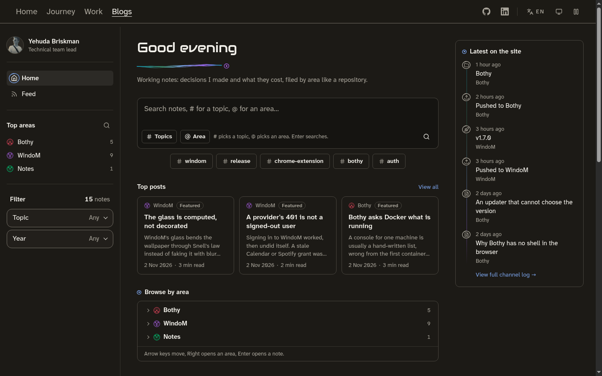
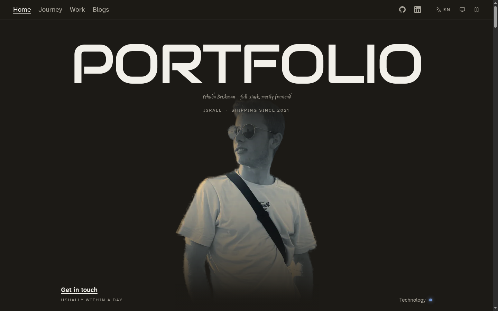
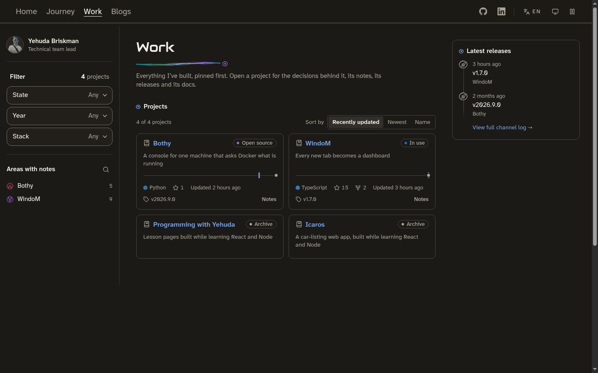

# yehudabriskman.com

**A bilingual (English and Hebrew) portfolio, blog and admin: a React SPA in
front of an Express API and CouchDB, released by image digest to a small k3s
cluster.**

[](https://github.com/YehudaBriskman/portfolio_site/actions/workflows/ci.yml)
[](https://github.com/YehudaBriskman/portfolio_site/actions/workflows/codeql.yml)
[](LICENSE)

**[Live site](https://yehudabriskman.com)** ·
**[Notes on how it is built](https://yehudabriskman.com/blog/area/site)** ·
**[Manual](docs/README.md)**



## What it is

The site of Yehuda Briskman, a technical team lead and full-stack developer.
It is three things in one codebase:

- **a portfolio**: the landing page, the Journey, and the projects with their
  write-ups and releases;
- **a blog of working notes**, filed by area like a repository, with search,
  topics, a feed and a channel log of releases and pushes;
- **an admin** where all of it is written, in both languages, with a media
  library and a translations dashboard.

Every page exists in English and, under `/he`, in Hebrew, right to left. The
API renders a real `<head>` per URL for crawlers and link previews, and draws
each page's social card on the fly. The content can also be edited from an AI
client through a remote [MCP](docs/manual/mcp.md) server.

| Landing | Work |
|---|---|
|  |  |

## Stack

| Part | Built with |
|---|---|
| `web/` | React 19, Vite 8, TypeScript, Tailwind CSS, Radix UI, TanStack Query, React Router, Shiki; served by nginx |
| `backend/` | Express, TypeScript, Zod, CouchDB (content, media and settings), sharp for image variants, resvg for social cards, pino logs, the remote MCP server |
| `mcp/` | a stdio MCP server over the API |
| Delivery | Docker, GitHub Actions, GHCR, Trivy, CodeQL, k3s |

## How it is built and deployed

```
pull request ──▶ only the checks the change needs ──▶ CI gate
push to main ──▶ build arm64 images ──▶ scan ──▶ GHCR by digest ──▶ release manifest ──▶ preprod
tag v*       ──▶ re-scan the same digests ──▶ production
```

Merging does not ship. Every commit on `main` is built, scanned, published and
deployed to a preprod copy of the site; production moves only when a release
is tagged, and a tag builds nothing: it promotes the exact digests `main`
already tested. Each rollout checks that the site answers and puts back what
ran before if it does not. The cluster itself is
[oci-free](https://github.com/YehudaBriskman/oci-free).
Details: [Deploy and release](docs/manual/deploy.md).

## Running it locally

Needs Docker with Compose; `make check` also needs Node 24.

```bash
make up      # build, start, and wait until http://localhost:8080 answers
make seed    # fixture posts, so /blog renders
make check   # exactly what CI runs on a pull request
make down    # stop; `make clean` also drops the content store
make         # every target
```

More, including running a service from source:
[Getting started](docs/manual/getting-started.md).

## Documentation

The manual is in [docs/](docs/README.md):

- [Getting started and local development](docs/manual/getting-started.md)
- [Admin and content guide](docs/manual/admin.md)
- [Media](docs/manual/media.md)
- [English and Hebrew](docs/manual/i18n.md)
- [MCP](docs/manual/mcp.md)
- [Deploy and release](docs/manual/deploy.md)

Design records (the motion contract, the accessibility and SEO audits, the
bilingual content design) are indexed there too. The reasoning behind the
bigger decisions is written up as notes on the site:
[yehudabriskman.com/blog/area/site](https://yehudabriskman.com/blog/area/site).

## Contributing

This is a personal project: **issues are welcome, pull requests are by
invitation.** Open an issue first; if a change makes sense you will be asked
for a PR there. See [CONTRIBUTING](.github/CONTRIBUTING.md) and the
[Code of Conduct](.github/CODE_OF_CONDUCT.md). Report security problems
privately, as described in the [security policy](.github/SECURITY.md).

## Licence

The **code** is [MIT](LICENSE). The **content** is not: the photographs, the
notes and posts, the story and site text, the images in `web/public/` and
`backend/content/`, and the screenshots under `docs/` are all rights reserved.
See [LICENSE-CONTENT](LICENSE-CONTENT) for the exact paths. If you build your
own site from this, keep the code and bring your own words and pictures.
